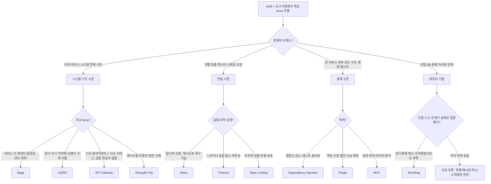

# 아키텍처 패턴 의사결정 차트

> **목적**: 에이전트가 심화 가이드(`architecture-patterns-guide.md`)를 읽기 **전에**,
> ADR(Architecture Decision Record)과 요구사항만 보고 *어떤 패턴(들)을 후보로 올릴지*
> 빠르게 좁히기 위한 라우팅 도구입니다. 이 차트는 "정답을 고르는 기계"가 아니라
> **후보군을 줄이고 확인해야 할 force를 짚어 주는 필터**입니다.

---

## 0. 전제 — 패턴마다 다루는 "단위"가 다르다

같은 '패턴'이라도 영향 범위가 다릅니다. 먼저 **문제의 단위**를 판별해야 엉뚱한
층위의 패턴을 비교하는 실수를 막습니다.

| 단위 | 영향 범위 | 패턴 |
|---|---|---|
| 시스템 구조 수준 | 여러 서비스·시스템 전체 | Saga · CQRS · API Gateway · Strangler Fig |
| 전술 수준 | 호출 하나를 어떻게 다룰지 | Retry · Timeout · Rate Limiting |
| 설계 수준 | 한 서비스 내부 코드 구조 | Dependency Injection · Plugin · MVC |
| 데이터 기법 | 데이터 저장·분산 방식 | Sharding |

> 핵심: **이들은 배타적이지 않습니다.** 하나의 요구사항이 여러 단위를 동시에 건드리면
> 각 단위에서 패턴을 하나씩 골라 **조합**합니다(예: API Gateway + Rate Limiting +
> Timeout + Retry).

---

## 1. 에이전트 사용 절차

1. **force 추출** — ADR의 `Context` / `Decision Drivers` / `Constraints`, 그리고 요구사항(기능·비기능)에서 다음을 뽑습니다.
   - 일관성 요구(강한 일관성 vs 최종 일관성 허용 여부)
   - 지연(latency) 목표, 처리량(throughput) 목표
   - 확장성·가용성 목표, 실패 모드(무엇이 어떻게 실패하나)
   - 레거시·조직·운영 역량 같은 제약
   - 변경 빈도(얼마나 자주 바뀌나), 비용 한계
2. **단위 분기** — 아래 플로차트로 문제의 단위를 먼저 정합니다.
3. **후보 매칭** — 해당 단위의 결정 표에서 force → 패턴을 매칭합니다.
4. **금지 조건 확인** — 각 후보의 "적용 금지/보류" 열을 반드시 확인합니다. 여기 걸리면 후보에서 제외하거나 선행 조치를 먼저 합니다.
5. **조합 구성** — 단위가 여럿이면 패턴을 조합하고, 상호작용(§4)을 점검합니다.
6. **기록** — 선택과 그 Consequences를 ADR의 `Decision` / `Consequences`에 남깁니다.

---

## 2. 단위 분기 플로차트

---

## 3. 단위별 결정 표

### 3-1. 시스템 구조 수준

| 신호(force) | 후보 패턴 | 선택하는 때 | 적용 금지 / 보류 |
|---|---|---|---|
| 여러 서비스에 걸친 업무를 하나의 "트랜잭션"처럼 묶어야 하고, 분산 2PC는 피하고 싶다 | **Saga** | 단계별 보상(compensation)이 업무적으로 정의 가능하고, 최종 일관성을 허용 | 강한 ACID·즉시 일관성이 필수인 금전 코어, 보상 불가능한 비가역 작업뿐일 때 |
| 읽기와 쓰기의 부하·모델·확장 축이 크게 다르다 | **CQRS** | 읽기 최적화 모델이 따로 필요하고, 읽기-쓰기 지연(최종 일관성)을 허용 | 읽기·쓰기 모델이 거의 같고 CRUD로 충분할 때(복잡도만 증가) |
| 클라이언트가 다수 서비스에 직접 결합, 인증·라우팅·집계 같은 공통 관심사가 흩어짐 | **API Gateway** | 진입점을 하나로 모아 cross-cutting을 집중시키고 싶을 때 | 서비스가 소수라 직접 호출이 단순할 때, 게이트웨이가 또 다른 단일 병목이 될 때 |
| 운영 중인 레거시를 멈추지 않고 조금씩 새 시스템으로 옮겨야 한다 | **Strangler Fig** | 빅뱅 재작성 리스크가 크고 점진 교체·롤백이 중요할 때 | 시스템이 작아 한 번에 재작성이 더 싸고 안전할 때 |

### 3-2. 전술 수준(복원력)

| 신호(force) | 후보 패턴 | 선택하는 때 | 적용 금지 / 보류 |
|---|---|---|---|
| 호출이 간헐적·일시적으로 실패한다(네트워크 순단, 일시적 5xx) | **Retry** | 대상 연산이 **멱등**하거나 멱등키로 만들 수 있을 때 | 비멱등 쓰기에 멱등 보장 없이 재시도, 이미 과부하인 대상에 무지성 재시도(폭주 증폭) |
| 의존성이 느리거나 응답이 없어 스레드·커넥션이 묶인다 | **Timeout** | 모든 외부 호출에 기본 적용(사실상 필수) | 타임아웃 없이 무한 대기 — 금지. 단, 값 없는 추정 설정도 위험(아래 가이드 참고) |
| 과부하·남용·비용 폭증으로부터 자원을 보호해야 한다 | **Rate Limiting** | 외부 공개 API, 공유 자원, 멀티테넌트 보호가 필요할 때 | 내부 신뢰 구간에 과도 적용해 정상 트래픽을 깎을 때 |

> 참고: 전술 수준에는 이미지에 없지만 **Circuit Breaker / Bulkhead / Fallback**이
> 짝으로 자주 붙습니다. Retry·Timeout만으로 연쇄 장애를 못 막으면 가이드의
> "함께 쓰는 패턴"을 확인하세요.

### 3-3. 설계 수준

| 신호(force) | 후보 패턴 | 선택하는 때 | 적용 금지 / 보류 |
|---|---|---|---|
| 구현체 교체·테스트 더블 주입이 필요하고 결합도를 낮추고 싶다 | **Dependency Injection** | 의존성이 바뀌거나 단위 테스트가 중요할 때(대부분의 서버 코드) | 바뀔 일 없는 사소한 의존까지 과도 추상화(간접화 비용만 증가) |
| 핵심을 건드리지 않고 제3자·런타임 기능 확장이 필요하다 | **Plugin** | 확장점(SPI)을 공개해 외부/팀이 기능을 더해야 할 때 | 확장 요구가 없는데 선제적으로 플러그인화(복잡도·보안면 증가) |
| 표현(View)·제어(Controller)·도메인(Model)이 뒤섞인다 | **MVC** | 요청-응답형 웹 계층의 관심사 분리 | 전 계층을 MVC로 간주해 비즈니스 로직을 컨트롤러에 몰아넣을 때 |

> 분류 주의: DI·Plugin·MVC는 **코드 구조에 가깝습니다**. iSAQB는 이를 아키텍처
> 패턴(R3)으로 분류하지만 디자인 패턴과의 경계에 있습니다. "시스템 전체"가 아니라
> "한 컴포넌트 내부"의 결정임을 전제로 다루세요.

### 3-4. 데이터 기법

| 신호(force) | 후보 패턴 | 선택하는 때 | 적용 금지 / 보류 |
|---|---|---|---|
| 단일 DB가 용량·쓰기 처리량 한계에 도달했다 | **Sharding** | 읽기 복제·캐시·인덱스·수직 확장을 **이미 소진**했고, 좋은 샤드 키가 있을 때 | 한계가 입증되지 않았을 때(조기 샤딩), 크로스 샤드 조인·트랜잭션이 지배적일 때 |

> 분류 주의: Azure는 Sharding을 패턴으로 분류하지만, 실무에서는 **DB 분할(파티셔닝)
> 기법**으로 다루기도 합니다. "아키텍처 선택"이라기보다 "데이터 확장 수단"으로 접근하세요.

---

## 4. 조합·상호작용 점검표

여러 패턴을 함께 쓸 때 서로를 망치지 않는지 확인합니다.

| 조합 | 주의할 상호작용 |
|---|---|
| Retry × Timeout | 재시도마다 타임아웃이 곱해져 **총 지연이 누적**됩니다. 전체 호출 체인에 **데드라인(budget)**을 두고 그 안에서만 재시도. |
| Retry × Rate Limiting | 429를 받고도 즉시 재시도하면 폭주를 키웁니다. `Retry-After` 존중 + 백오프+지터. |
| Saga × Retry | 보상·단계 실행 도구는 **중복 호출에 안전(멱등)**해야 합니다. 재시도로 두 번 실행될 수 있음. |
| CQRS × Saga | 읽기 모델은 최종 일관성이므로, 사가 진행 중 조회가 **중간 상태**를 볼 수 있음을 설계에 반영. |
| API Gateway × (Timeout/Retry/Rate Limiting) | 게이트웨이가 cross-cutting을 집중 적용하기 좋은 지점이지만, 게이트웨이 자체가 단일 병목·장애점이 되지 않게 HA·격리. |
| Sharding × 크로스 샤드 트랜잭션 | 샤드를 넘는 일관성은 다시 Saga/2PC 문제로 환원됩니다. 샤드 키를 업무 경계에 맞춰 **크로스 샤드를 최소화**. |
| Strangler Fig × 데이터 | 전환 기간 동안 레거시-신규 간 **데이터 동기화/이중 쓰기**와 정합성 검증이 핵심 리스크. |

---

## 5. 빠른 역매핑 (요구사항 → 패턴)

ADR에서 자주 나오는 표현을 패턴으로 바로 잇습니다.

| ADR·요구사항에 이런 말이 보이면 | 먼저 볼 패턴 |
|---|---|
| "서비스 간 일관성", "분산 트랜잭션", "2PC 피함", "보상" | Saga |
| "읽기 확장", "조회 전용 모델", "읽기/쓰기 분리" | CQRS |
| "단일 진입점", "BFF", "인증·라우팅 일원화", "응답 집계" | API Gateway |
| "레거시 점진 교체", "무중단 마이그레이션", "빅뱅 금지" | Strangler Fig |
| "일시적 오류", "복구 가능 실패", "멱등" | Retry |
| "행 스레드/커넥션 고갈", "느린 의존성 차단", "데드라인" | Timeout |
| "쿼터", "스로틀링", "남용 방지", "429", "멀티테넌트 보호" | Rate Limiting |
| "테스트 용이성", "구현체 교체", "결합도" | Dependency Injection |
| "확장점", "SPI", "제3자 모듈", "런타임 로딩" | Plugin |
| "표현/로직 분리", "컨트롤러", "뷰" | MVC |
| "단일 DB 한계", "수평 확장", "파티셔닝", "샤드 키" | Sharding |

---

## 6. 결정 기록 — 형식은 여기 없다

ADR 형식의 **단일 소스는 [document-template.md](document-template.md)** 의 "ADR 파일 본문 형식"
블록이다. 이 차트가 자기 템플릿을 따로 들고 있으면 두 형식이 서로 다른 속도로 자라고, 그러면
에이전트가 어느 쪽을 채워야 할지 모른다. **차트는 그 형식의 `근거(Forces)`·`검토했으나 제외`·
`결정` 칸을 채우는 입력**이고, 구조적 성립 여부는 [clean-architecture-rules.md](clean-architecture-rules.md)
§A가 판정한다.

> 크기(단위)는 달라도, 이 패턴들은 모두 **반복되는 문제에 대한 검증된 해법**입니다.
> 차트로 후보를 좁힌 뒤에는 반드시 가이드의 구현 체크리스트로 세부 리스크를 확인하세요.
